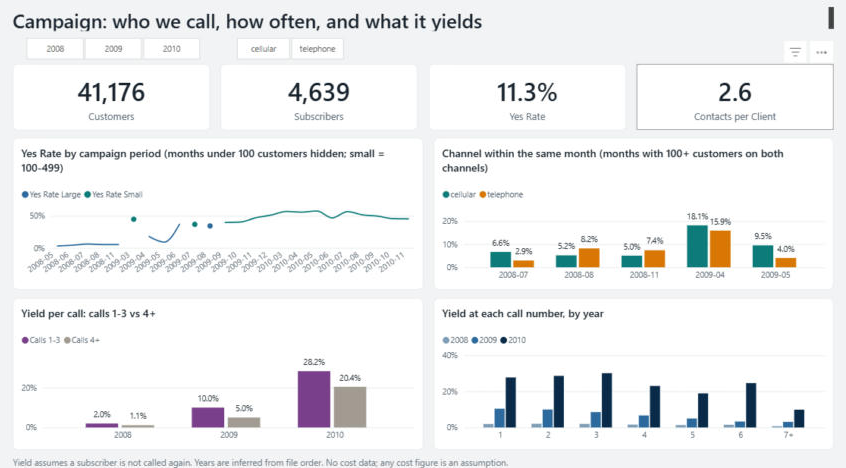
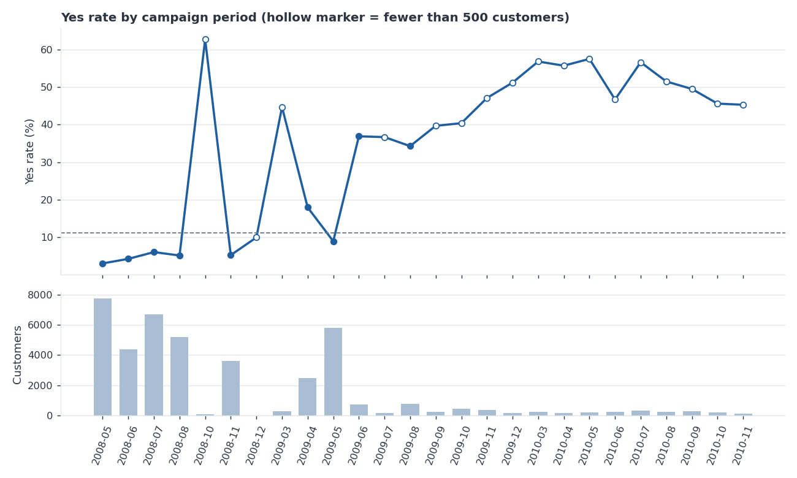
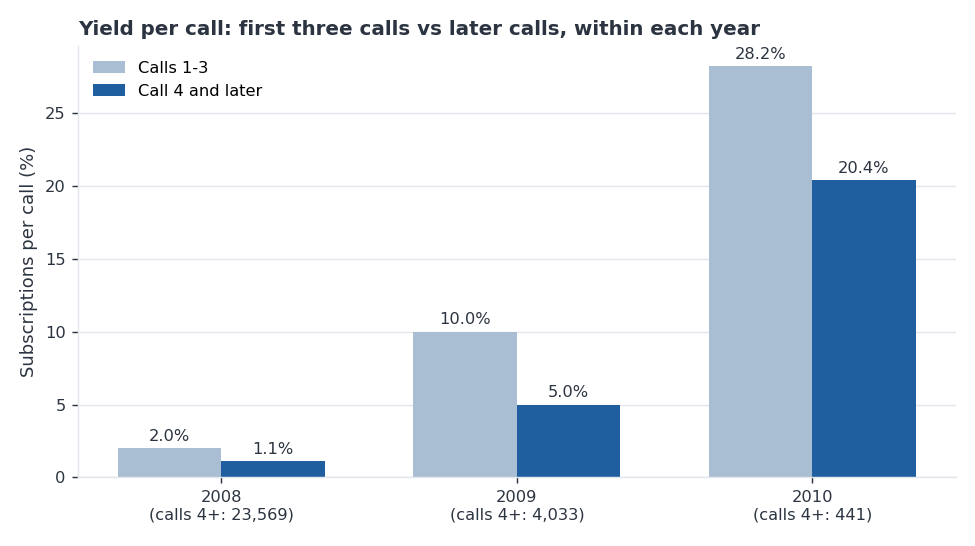
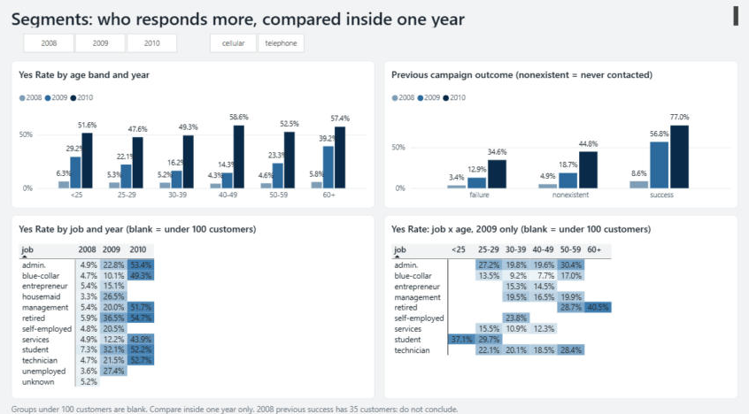
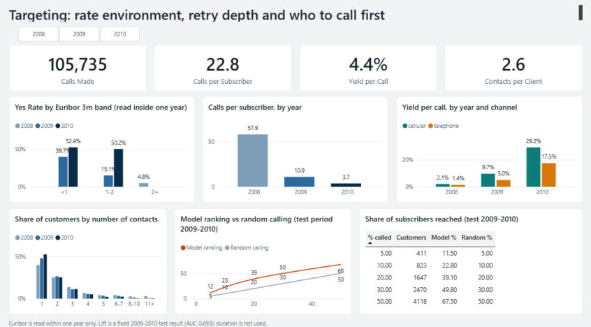
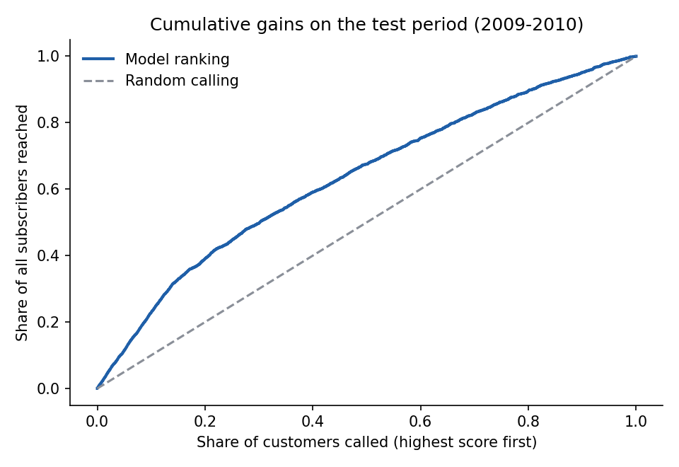

# Bank Marketing: Who to Call First, and When to Stop

An analysis of a retail bank's term-deposit telemarketing campaign: which clients to call first, and when repeat calls stop paying off.

**Tools:** SQL (SQLite) · Power BI (DAX) · Python (pandas, scikit-learn, matplotlib)
**Data:** [UCI Bank Marketing](https://archive.ics.uci.edu/dataset/222/bank+marketing) (Portuguese bank, 2008-2010)

## Table of Contents

- [Project Background](#project-background)
- [Executive Summary](#executive-summary)
- [Insights Deep-Dive](#insights-deep-dive)
  * [Campaign Results by Period](#campaign-results-by-period)
  * [Campaign Fatigue](#campaign-fatigue)
  * [Previous Campaign Outcome](#previous-campaign-outcome)
  * [Segments, Channel and Rate Environment](#segments-channel-and-rate-environment)
  * [Supporting Model: Ranking the Call List](#supporting-model-ranking-the-call-list)
- [Recommendations](#recommendations)
- [Assumptions and Caveats](#assumptions-and-caveats)
- [Repository Structure](#repository-structure)

---

## Project Background

A retail bank phones clients to sell a term deposit. Every call costs agent time, and the same client can be called many times. I'm supporting the operations manager who has to decide **who the team should call first, and when to stop calling**.

The dataset has 41,188 call records (20 features plus the outcome `y`). After removing 12 duplicate rows it covers 41,176 clients, of whom 4,639 subscribed. The cleaned table `bank_clean` has 28 columns: the 21 source columns plus 7 added in [`01_data_check.ipynb`](Exploration/01_data_check.ipynb) (`source_row`, `year`, `campaign_period`, `y_flag`, `previously_contacted`, `age_band`, `campaign_band`). Rows are in date order and `year` is inferred from that order, because the file has no date column. There is no cost data, so nothing here is a savings estimate.

## Executive Summary

The overall conversion rate is **11.3%**, but that number hides the real story: it was **4.8% in 2008, 19.5% in 2009 and 52.1% in 2010** (years inferred from file order). Calls per subscriber fell from **57.9 to 10.9 to 3.7**, a gap of more than 15x that the pooled figure of 22.8 conceals. Every conclusion below is therefore checked inside each campaign year.

Three findings hold across years and are safe to act on:

1. Clients with a **previous successful campaign** convert **1.7-3.0x** more than never-contacted clients (2009 and 2010).
2. **Calls 4 and later** yield only **0.50-0.72x** of calls 1-3, yet make up 26.5% of all calls and 12.0% of subscriptions.
3. Clients who **previously refused** convert less than never-contacted clients in all three years (0.69-0.77x), the opposite of what the pooled data suggests.

Channel, age, job and interest-rate effects appear in the pooled data but cannot be separated from the campaign period, so they are treated as hypotheses to test, not rules.



## Insights Deep-Dive

### Campaign Results by Period

- Yes rate: 4.8% [4.6, 5.1] in 2008, 19.5% [18.8, 20.2] in 2009, 52.1% [50.0, 54.3] in 2010 (95% intervals).
- Calls per subscriber: 57.9 (2008), 10.9 (2009), 3.7 (2010).
- 2010 has only 2,058 rows and is probably a different sample of clients, so it is not read as a trend.
- The data does not say why results differ (who was called, what was offered, the economy). Campaign context should be requested before comparing campaigns.



### Campaign Fatigue

- Yield per call for calls 4+ is 0.56x (2008), 0.50x (2009) and 0.72x (2010) of calls 1-3.
- Calls 4+ are 26.5% of all calls but 12.0% of subscriptions; 88.0% of subscriptions are reached by call 3.
- A lower yield is not a loss: calls 4+ still convert at 1.1%, 5.0% and 20.4% in 2008-2010. The real saving depends on cost per call, which the data does not contain.
- Part of the drop is a survivor effect: clients who reach call 5 are, by construction, the ones who kept saying no.



### Previous Campaign Outcome

- **Previous success:** 56.8% vs 18.7% for never-contacted (3.04x) in 2009, and 77.0% vs 44.8% (1.72x) in 2010. In 2009 these clients were 6.0% of customers but 17.6% of subscribers. 2008 has only 35 such clients, so no conclusion is drawn for that year.
- **Previous failure:** lower than never-contacted in every year (0.71x, 0.69x, 0.77x), clearly so in 2009 and 2010. The 2008 interval [0.47, 1.05] includes 1.
- Pooled, previous-failure clients look better (14.2% vs 8.8%). That is a year-mix effect (Simpson's paradox): they are over-represented in the high-converting later years.



### Segments, Channel and Rate Environment

- **Age and job:** in 2008 (two thirds of the data) every age band sits at 4.3-6.3% and every job at 3.3-7.3%. Differences appear only in 2009, for example 60+ at 39.2%, retired 36.5% and student 32.1% against blue-collar 10.1%.
- **Channel:** pooled, cellular converts 14.7% vs 5.2% for telephone. Inside the same month it is higher in 3 of 5 comparable months and lower in 2, and there were no cellular calls in May-June 2008, so the gap mostly reflects when each channel was used.
- **Euribor:** the 2%+ band is exactly the 2008 clients, so the rate environment cannot be separated from the year.



### Supporting Model: Ranking the Call List

- Logistic regression with `duration` excluded (it is only known after the call), tested on a time-based split (train mostly 2008, test 2009-2010).
- ROC-AUC 0.693 on test. Calling the top 20% by score reaches 39.1% of subscribers (lift 1.95x vs random).
- Used as a tie-breaker inside a group, not as a decision rule: probabilities are not calibrated across periods and recall at a 0.5 threshold is only 7.0%.



## Recommendations

**Prioritise the call list**
- **Put previous-success clients at the top.** Highest impact and confidence: two years, intervals far from 1.
- **Rank previous refusals below never-contacted clients**, or at least no higher. Confidence: medium.
- **Use the model score as a tie-breaker** inside each group.

**Review retry rules**
- **Pilot a cap after the 3rd call** for a random half of the list, then compare subscriptions and call cost. Upper bound if the cap loses every 4+ subscription: 12.0% of subscriptions for 26.5% of calls. No saving should be quoted until a cost per call is supplied and labelled as an assumption.

**Measure better**
- **Always report results inside a campaign period**, never pooled.
- **Run a randomised channel test** before choosing cellular over telephone.
- **Request four fields** that would close the main gaps: a real campaign date, a customer ID, per-call outcomes and cost per call.

## Assumptions and Caveats

- **Not Thai data:** a Portuguese bank, 2008-2010. Results should not be generalised to another market.
- **Year is inferred** from row order (a month that goes backwards marks a new year); the file has no date column.
- **Last-call assumption:** a subscriber is assumed to have said yes on their last call. This drives the per-call yield figures.
- **No cost data:** no savings figure is claimed anywhere.
- **Associations, not causes.** No multiple-comparison correction was applied, so single-year findings are labelled leads. Confidence intervals treat calls and customers as independent, which slightly understates uncertainty.
- **Data quality:** `unknown` values are counted as missing; `pdays` (999 = never contacted) disagrees with `previous` and is dropped from the model; `duration` is excluded as leakage.
- **Excel warning:** do not open and re-save `Data/bank_clean.csv` in Excel, because "6-7" and "8-10" turn into dates. The loader in `bm_analysis.py` stops with a message if the file is damaged.

---

- See data checks and every cleaning decision in the [data check notebook](Exploration/01_data_check.ipynb).
- See the EDA in the [EDA notebook](Exploration/02_eda.ipynb) and the model in the [model notebook](Exploration/03_model.ipynb).
- See the 13 SQL queries in the [SQL file](Exploration/bank_marketing_queries.sql).
- See the [Power BI dashboard](Exploration/Bank_Marketing_Dashboard.pbix) (3 pages; it reads `Data/bank_clean.csv`, so re-point the data source after cloning).

## Repository Structure

```
├── README.md
├── requirements.txt
├── Data/
│   ├── bank-additional-full.csv     raw UCI file (';' separated)
│   └── visualizations/              dashboard screenshots and charts used above
└── Exploration/
    ├── 01_data_check.ipynb          cleaning decisions, writes Data/bank_clean.csv
    ├── 02_eda.ipynb                 campaign fatigue, segments, channel, rate environment
    ├── 03_model.ipynb               supporting logistic regression
    ├── bm_analysis.py               shared helper functions
    ├── bank_marketing_queries.sql   13 business-question queries
    └── Bank_Marketing_Dashboard.pbix
```

To reproduce: `pip install -r requirements.txt`, then run the notebooks in order from inside `Exploration/` (`01` creates `Data/bank_clean.csv`, which `02` and `03` and the SQL file need).

*Reference: Moro, S., Cortez, P., Rita, P. (2014). A Data-Driven Approach to Predict the Success of Bank Telemarketing. Decision Support Systems.*
